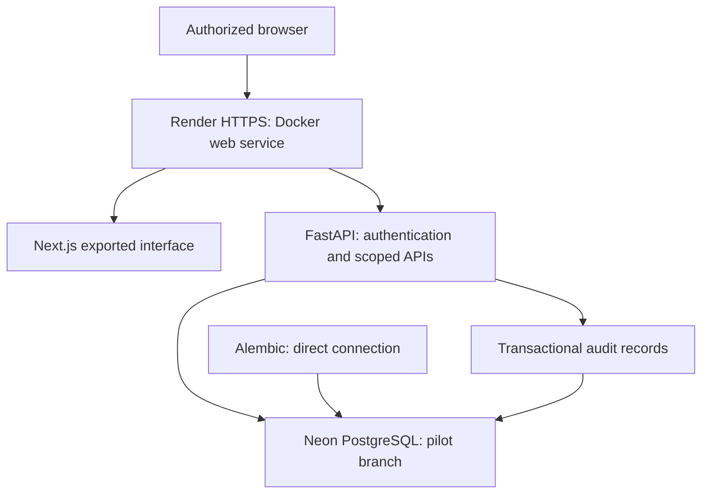
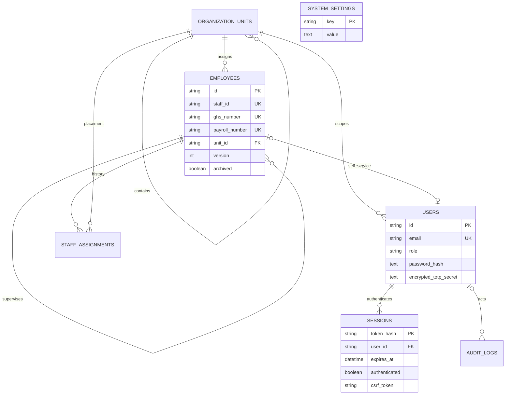

# Phase 1 architecture

The Next.js client calls same-origin FastAPI endpoints, never the database. FastAPI owns authentication and scope enforcement. Exported Next.js assets and Python API run in a single portable container. Application traffic uses pooled PostgreSQL; Alembic uses its direct URL. Render can be replaced with another container host and Neon with standard approved PostgreSQL.

## Implemented ERD

Executable schema: `backend/migrations/versions/aade32d24ec0_phase_1_personnel_and_access_foundation.py`. Offline PostgreSQL schema: `docs/schema.sql`. UUID values are stored as portable 36-character strings; session IDs are SHA-256 token hashes. Foreign keys preserve references. Staff IDs, optional GHS/payroll numbers, emails and employee-account links are unique. Empty official identifiers become NULL. Sibling unit names are unique. Indexes cover search/scope fields and audit timestamps.

Phase 1 uses a single master personnel record with personal, employment and professional information. Normalize contacts, qualifications and licences into versioned child tables when multiple values are introduced. This pilot does not claim the Phase 2–4 tables are implemented. Initial assignments are preserved and direct reassignment is blocked until transfer approvals exist. Archival preserves personnel/history. Change logs list modified field names without copying confidential values.

## Permissions matrix

| Role | Personnel visibility | Personnel writes | Units/vocabulary | Accounts | Audit |
|---|---|---|---|---|---|
| Platform administrator | None | None | Unit names only | Platform accounts only | No |
| District director | District, limited fields | No | View | No | No |
| HR administrator | District, full profile | Create/edit/import/verify/archive | Manage | Non-platform accounts | Read |
| HR officer | District, full profile | Create/edit/import/verify | View | No | No |
| Sub-district head | Assigned subtree, limited fields | No | Scoped and ancestors | No | No |
| Facility in-charge | Assigned facility subtree, limited fields | No | Scoped and ancestors | No | No |
| Department head | Assigned department, limited fields | No | Scoped and ancestors | No | No |
| Employee | Own profile only | Own password only | Own unit ancestry | No | No |
| Auditor | None | None | No | No | Read |

Roles are a controlled enumeration; independent multi-role permission assignments are deferred. One pilot district is supported. Expansion requires tenant keys and cross-district isolation tests. API scopes are enforced; PostgreSQL RLS is not implemented in this phase. Privileged accounts must complete MFA before workspace access. Temporary password changes are required at the API boundary.

## Project structure

- `backend/app`: models, input validation, authentication, API, seed and recovery command.
- `backend/migrations`: Alembic environment and immutable revisions.
- `backend/tests`: critical access and workflow tests.
- `frontend/app`: Next.js interface and responsive theme.
- `docs`: schema, architecture, phase plan, guides and operations.
- `Dockerfile`, `render.yaml`: portable container and pilot hosting.
- `.github/workflows/ci.yml`: backend/migration/frontend verification.
